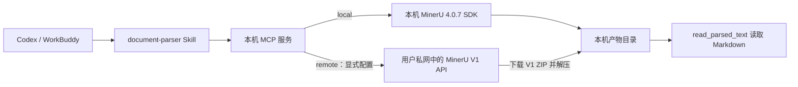

# Yushu Document Parser

把 PDF、图片、Office、OpenDocument、EPUB、OFD、HTML/MHTML 等文档解析能力包装成 **Agent Skill + MCP 服务**，让 Codex、WorkBuddy 等 MCP 客户端可以调用 MinerU 4.0.7 提取正文，并在本机保存 Markdown、结构化 JSON 和文档中的图片。

项目面向 Windows 桌面端，支持两种明确选择的解析方式：本机运行 MinerU，或把文件发送到用户自己部署在私网中的 MinerU API。两种方式使用相同的 MCP 工具和产物格式。

> 本项目只负责文档解析和产物读取。图片会提取为文件，不会自动生成图片描述；项目不负责摘要、翻译、知识库构建或向量检索。

## 目录

- [来源与项目关系](#来源与项目关系)
- [能力范围](#能力范围)
- [工作流程](#工作流程)
- [MCP 工具](#mcp-工具)
- [输出文件](#输出文件)
- [Windows 安装](#windows-安装)
- [选择本机或云端后端](#选择本机或云端后端)
- [云端部署](#云端部署)
- [安全与隐私](#安全与隐私)
- [常见问题](#常见问题)
- [开发与测试](#开发与测试)
- [许可与致谢](#许可与致谢)

## 来源与项目关系

本仓库中的 MCP 服务、Skill、Windows 安装器和 Docker Compose 模板，是围绕项目原有的 MinerU 文档解析工作流整理出的独立适配代码。**实际执行 PDF、图片和 Office 内容识别的引擎来自 OpenDataLab 官方 [MinerU 项目](https://github.com/opendatalab/MinerU)**，当前安装器和容器模板固定安装 MinerU 4.0.7。

本仓库不是 MinerU 的 fork，也不复制或重新分发 MinerU 源码、模型权重或运行环境。运行本项目时，安装器或 Docker 构建过程会单独从上游包源安装 MinerU；模型在首次解析时按 MinerU 配置下载。这里新增的代码负责把 MinerU 的 Python SDK/V1 API 接入 MCP 工具，管理输入、产物目录、远程任务和客户端配置。

| 组成 | 来源 | 本仓库是否包含 |
| --- | --- | --- |
| 文档版面分析、OCR 与内容提取引擎 | [OpenDataLab/MinerU](https://github.com/opendatalab/MinerU)，固定版本 4.0.7 | 否，安装时单独获取 |
| MCP 适配器与三项工具 | 本仓库 | 是 |
| 给 AI 的工具选择和结果读取指引 | 本仓库 `SKILL.md` | 是 |
| Windows 安装与 Codex/WorkBuddy 配置合并 | 本仓库 `scripts/install.ps1` 和 Python 模块 | 是 |
| 云端 API 容器模板 | 本仓库 `cloud/`，容器内安装 MinerU | 是模板，不含模型 |
| 用户文件、解析结果和模型缓存 | 由用户的运行环境生成 | 不纳入仓库 |

## 能力范围

### 支持输入

| 类型 | 扩展名 |
| --- | --- |
| PDF | `.pdf` |
| 图片 | `.png`、`.jpg`、`.jpeg`、`.webp`、`.bmp`、`.tif`、`.tiff` |
| Word | `.doc`、`.docx` |
| PowerPoint | `.ppt`、`.pptx` |
| Excel | `.xls`、`.xlsx` |
| 其他文档 | `.rtf`、`.odt`、`.ods`、`.odp`、`.epub`、`.ofd` |
| 网页与表格数据 | `.html`、`.htm`、`.mhtml`、`.mht`、`.csv`、`.tsv` |

MinerU 4.0.7 新增 MHTML/MHT 网页归档解析。`.txt`、`.md` 等纯文本本身已可直接阅读，不需要调用解析工具。

### 能做什么

- 解析单个文件，或按给定顺序逐个解析多个文件。
- 提取文本和版面结构，保存 Markdown、MinerU 4 `structured_content.json`、`middle_json.json` 和 ZIP 产物中的图片。
- 保存解析结果中包含的图片文件。
- 分段读取解析后的 Markdown，或在确有需要时读取全文。
- 将产物保存在本机；重复解析不会覆盖已有结果，而会分配新目录。
- 批处理逐文件返回成功或失败状态；某一文件失败不会中止其余文件。
- 显式选择本机或已配置的远程后端。所选后端不可用时会报告错误，不会暗中改走另一后端。

### 当前边界

- **不生成图片描述。** 解析出的图片会保留在 `images/`，需要理解图片时应由后续具备视觉能力的模型读取图片。
- **不保证识别零错误。** 扫描质量、倾斜、手写内容、复杂表格和特殊字体都会影响 OCR 与版面结果；重要内容需要人工复核。
- **不扫描目录。** 工具接收文件路径列表，不会递归查找目录中的文件。
- 不修改输入文件，不做摘要、翻译、问答、分类、向量化或知识库写入。
- 支持的输入格式和 MinerU 的原生能力可能不同；本服务只开放上表列出的格式。

## 工作流程



Skill 会提醒 AI：先解析，再根据返回的路径读取正文；长文按段读取；检查每个批处理文件的状态；不要把已选后端失败解释为自动切换成功。

## 与 Cognition-Loom-skills 配合

本项目可以作为书籍技能工作流的**文档预处理环节**，与 [Cognition-Loom-skills](https://github.com/lan99988/Cognition-Loom-skills) 中的 [`book-to-skill`](https://github.com/lan99988/Cognition-Loom-skills/tree/main/book-to-skill) 配合使用：先用本项目把 PDF 或 Office 文件解析为 Markdown，并提取相关图片；再由 `book-to-skill` 对整理后的书籍正文进行章节结构化提取，生成章节摘要、术语表和速查表等 Skill 内容。

这两个仓库可以独立安装和使用。`yushu-document-parser` 不会自动调用或安装 `book-to-skill`；用户可在同一个 AI 客户端中安装两边的 Skill，并根据需要把解析得到的 Markdown 和图片交给后续技能处理。文档解析结果是否完整、图片是否需要单独查看，应在进入书籍提炼步骤前确认。

## MCP 工具

服务通过标准输入/输出（stdio）启动，MCP server 名称为 `document-parser`。安装器负责为 Codex 和 WorkBuddy 注册服务。

### `parse_document`

解析一个文件，返回输入路径、所用后端、状态、产物路径和短预览。

| 参数 | 类型 | 默认值 | 说明 |
| --- | --- | --- | --- |
| `file_path` | 字符串 | 必填 | 本机可访问的文件路径；支持中文和空格路径 |
| `tier` | `auto` / `flash` / `basic` / `standard` / `advanced` | `auto` | `auto` 对 PDF/图片使用 standard，其他原生格式使用 flash；原生格式只能使用 flash |
| `backend` | `local` / `remote` | 安装配置的后端 | 可对单次调用显式选择后端 |

### `parse_documents`

按传入顺序逐个解析一组文件。每项结果独立报告状态、后端与产物；单项失败不会打断后续文件。

| 参数 | 类型 | 默认值 | 说明 |
| --- | --- | --- | --- |
| `file_paths` | 字符串数组 | 必填 | 有序的本机文件路径列表 |
| `tier` | `auto` / `flash` / `basic` / `standard` / `advanced` | `auto` | 每个文件按扩展名自动选择档位，或统一指定档位 |
| `backend` | `local` / `remote` | 安装配置的后端 | 整个批次统一使用所选后端 |

### `read_parsed_text`

读取 `parse_document` 返回的 Markdown 文件路径。默认一次最多读取 200 行，结果会返回 `next_line` 和 `has_more`，便于继续读取。

| 参数 | 类型 | 默认值 | 说明 |
| --- | --- | --- | --- |
| `markdown_path` | 字符串 | 必填 | 解析结果中的 Markdown 文件路径 |
| `start_line` | 整数 | `1` | 从第几行开始读取，行号从 1 开始 |
| `max_lines` | 整数 | `200` | 单次读取的最大行数 |
| `full` | 布尔值 | `false` | 设为 `true` 时读取全文 |

简化调用示例：

```json
{
  "file_path": "D:/资料/年度报告.pdf",
  "tier": "auto",
  "backend": "local"
}
```

AI 客户端应先查看解析工具返回值中的 `markdown_path`，再将该路径传给 `read_parsed_text`。解析工具只返回短预览，避免长文在解析阶段占用过多上下文。

## 输出文件

默认输出目录：

- Windows：`%LOCALAPPDATA%\DocumentParser\output`
- Linux/macOS：`~/.local/share/document-parser/output`

每个输入文件会写入独立、不冲突的目录，典型结构如下：

```text
output/
  年度报告/
    markdown.md
    structured_content.json
    middle_json.json
    images/
      image_1.png
```

目录和文件的实际命名以工具返回的绝对路径为准。重名输入或重跑会使用递增目录名，保留已有产物。`structured_content.json` 保存面向下游工具的结构化内容，`middle_json.json` 保存 MinerU 4 中间文档结构；图片被提取到 `images/`。

## Windows 安装

### 环境要求

- Windows 10/11。
- Python 3.10–3.14，并能在 PowerShell 中运行 `python`。
- 本机后端需要足够的磁盘空间存放 MinerU 依赖和模型。NVIDIA GPU 可加速 PDF/图片的 standard/advanced 档；没有检测到可用 GPU 时，安装器会询问是否继续安装 CPU 版，CPU 解析通常慢很多。
- 云端后端只要求本机 MCP 的 Python 依赖与网络可达，不需要在 Windows 安装 MinerU 引擎或模型。

### 本机解析模式

在下载或克隆的仓库目录中打开 PowerShell：

```powershell
Set-ExecutionPolicy -Scope Process Bypass
.\scripts\install.ps1
```

安装器会创建隔离 Python 环境，将 MCP 程序安装到 `%LOCALAPPDATA%\DocumentParser\app`，将产物写入 `%LOCALAPPDATA%\DocumentParser\output`，并安装 Skill 到：

- `%USERPROFILE%\.codex\skills\document-parser\SKILL.md`
- `%USERPROFILE%\.workbuddy\skills\document-parser\SKILL.md`

同时它会备份并合并 Codex 和 WorkBuddy 的 MCP 配置，不覆盖已有的其他 MCP 服务；重复运行会更新本服务配置，不会重复添加。安装完成后重启两个客户端以加载工具和 Skill。MinerU 模型在首次解析时下载。

从本仓库 3.2.3 适配版升级时，可以重新运行此安装器：它会备份并合并客户端配置、更新 MCP 程序和 Skill，并将本机 MinerU 固定更新到 4.0.7。4.x 的模型缓存与配置和旧版不同，首次解析可能需要重新下载模型。

### 使用自有云端解析

如果已按[云端部署](#云端部署)启动 API：

```powershell
.\scripts\install.ps1 -Backend remote -RemoteUrl "http://100.64.0.10:8000" -RemoteToken "与服务器相同的 API 密钥"
```

也可以使用 Tailscale MagicDNS 地址，例如 `http://mineru.tailnet-name.ts.net:8000`。安装器会检查目标属于 Tailscale 或常见私网地址。remote 模式不安装本机 MinerU；选择 remote 表示所选文件会上传到所配置的服务器进行解析。若云端 `.env` 设置了 `MINERU_API_KEY`，客户端要通过 `-RemoteToken` 配置同一密钥。

## 选择本机或云端后端

| 模式 | 文件在哪里解析 | 文件是否离开本机 | 适合场景 |
| --- | --- | --- | --- |
| `local`（默认） | 当前 Windows 电脑 | 否 | 文件需要留在本机；有足够本机算力和磁盘 |
| `remote`（需显式配置） | 用户自己的 MinerU API 服务器 | 是，文件会上传到该服务器 | 希望使用自有服务器的 GPU 或集中管理模型 |

安装选择会写入 MCP 配置中的后端环境变量。单次工具调用也可以显式指定 `backend`。MinerU 4 使用 `tier` 选择解析质量：默认 `auto` 对 PDF/图片选 standard，对原生文档选 flash。V4 不再使用旧版 `language` 参数，OCR 语言由引擎自动处理。如果远程 URL 未设置或服务报错，工具只返回错误，不自动上传到其他地方或切回本机。

MCP 服务识别以下环境变量，可用于手动配置或排障：

| 变量 | 说明 |
| --- | --- |
| `DOCUMENT_PARSER_BACKEND` | `local` 或 `remote`；默认 `local` |
| `DOCUMENT_PARSER_REMOTE_URL` | 远程 MinerU API 基础地址，例如 `http://100.64.0.10:8000` |
| `DOCUMENT_PARSER_REMOTE_TOKEN` | 可选 Bearer Token；与云端 `.env` 中的 `MINERU_API_KEY` 一致 |
| `DOCUMENT_PARSER_OUTPUT_DIR` | 本机产物根目录 |
| `DOCUMENT_PARSER_POLL_INTERVAL` | 远程任务轮询间隔秒数，默认 `3` |
| `DOCUMENT_PARSER_MAX_WAIT_SECONDS` | 远程任务最大等待时间，默认 `1800` |

## 云端部署

仓库提供 Linux Docker Compose 模板，不绑定特定云厂商。服务器先安装 Docker Engine/Compose 和 Tailscale，并加入你自己的 tailnet。默认模板使用 CPU；模型缓存和 API 输出保存在 Docker 卷中。

```bash
cd cloud
cp .env.example .env
# 编辑 .env，将 TAILSCALE_IP 改为本机的 Tailscale IPv4 地址
docker compose build
docker compose up -d
```

首次构建默认安装 MinerU 4.0.7 CPU 基础运行时；启用 GPU 覆盖配置时安装 `mineru[full]==4.0.7`。第一次解析时下载模型。可以从已加入 tailnet 的设备检查健康状态：

```bash
curl http://100.64.0.10:8000/v1/health
```

可在 `cloud/.env` 中设置 `MINERU_API_KEY` 启用 V1 API bearer key；Windows 客户端安装时使用相同的 `-RemoteToken`。服务仍绑定到 Tailscale 地址，不要映射到公网接口。

### 可选 GPU

启用 GPU 前，在服务器安装与 NVIDIA 驱动匹配的 NVIDIA Container Toolkit，并根据实际驱动选择官方兼容的 PyTorch CUDA wheel 源，在 `cloud/.env` 中设置 `TORCH_INDEX_URL`。然后运行：

```bash
docker compose -f docker-compose.yml -f docker-compose.gpu.yml build
docker compose -f docker-compose.yml -f docker-compose.gpu.yml up -d
```

GPU 驱动、CUDA wheel 与服务器配置必须匹配；仓库不预设某个云厂商或 GPU 型号。

## 安全与隐私

- 本机后端由本机 MCP 进程读取传入路径并调用本机 MinerU；不把文件上传到本项目维护的服务器。
- 远程后端会把完整输入文件发送到 `DOCUMENT_PARSER_REMOTE_URL` 指向的 MinerU API，并把解析 ZIP 下载回本机。该服务器由使用者自行选择、部署和管理。
- Docker Compose 将 API 端口绑定到 `.env` 中的 `TAILSCALE_IP`，模板不应改为 `0.0.0.0`，也不要把 API 暴露在公网或公开反向代理之后。
- API key 可以通过 `MINERU_API_KEY` 启用；无 key 时，访问控制依赖 Tailscale 私网与 ACL。两种配置都只应允许需要的设备访问 TCP 8000，不要把服务公开到公网。
- 远程任务及模型的保留、清理策略由 MinerU API 和服务器卷配置决定。部署者应自行设置访问控制、磁盘容量和数据保留周期。
- 仓库不包含用户文档、模型缓存、解析产物或其他项目资料；`.env` 等本地配置由 `.gitignore` 排除。

## 常见问题

**安装时没有检测到 NVIDIA GPU，能否使用？**

可以选择继续安装 CPU 版。解析速度通常较慢；也可以取消本机安装，改用自己部署的 remote 后端。

**为什么第一次解析很久？**

MinerU 可能需要首次下载模型。下载速度取决于模型源和网络；云端模式的模型在服务器第一次解析时下载。

**解析成功但没有图片描述？**

这是预期行为。工具会返回图片文件路径，不调用图像理解模型。

**能否直接把整个文件夹交给工具？**

当前工具不遍历文件夹。请传入明确的文件路径列表；批处理按照列表顺序执行。

**remote 连接失败后会自动用本机处理吗？**

不会。工具会报告错误，以免文件在没有明确选择的情况下被上传或切换到另一套引擎。

**如何卸载？**

先从 Codex 与 WorkBuddy 配置中删除 `document-parser` MCP 条目，再删除安装器创建的应用目录、产物目录和两个客户端中的 `document-parser` Skill 目录。配置备份文件由安装器保留，便于恢复。

## 开发与测试

需要 Python 3.10–3.14 和 `uv`：

```powershell
uv sync --no-install-project
$env:PYTHONPATH = "src"
uv run --no-sync python -m unittest discover -s tests -v
```

测试覆盖 MinerU SDK 适配、V1 上传和任务轮询、跨域对象存储凭证隔离、ZIP 下载与路径安全校验、原生文件档位选择、中文及空格路径、重复输出目录、批处理失败隔离、客户端配置备份与合并、Skill 工具契约和云端模板。远程接口测试使用模拟 HTTP 传输；它不需要真实服务器。端到端运行 MinerU 仍需要安装上游引擎并下载模型。

## 许可与致谢

本仓库独立适配代码采用 [MIT License](LICENSE)。MinerU 是单独获取和运行的上游项目，其许可**不由本仓库的 MIT 许可证替代**。上游当前许可说明 MinerU 采用 Apache License 2.0 并附加商业门槛与在线服务标识条款；若你基于 MinerU 向第三方提供在线服务，应在产品界面或公开文档显著标明使用了 MinerU。使用前请阅读官方 [MinerU LICENSE.md](https://github.com/opendatalab/MinerU/blob/master/LICENSE.md) 和 [Apache License 2.0](https://www.apache.org/licenses/LICENSE-2.0)。MinerU 模型可能另有许可，需按下载来源单独核对。

感谢 [OpenDataLab](https://github.com/opendatalab) 及 MinerU 项目提供文档解析引擎。本仓库是对上游工具的独立适配，不代表 OpenDataLab 官方项目或其背书。
